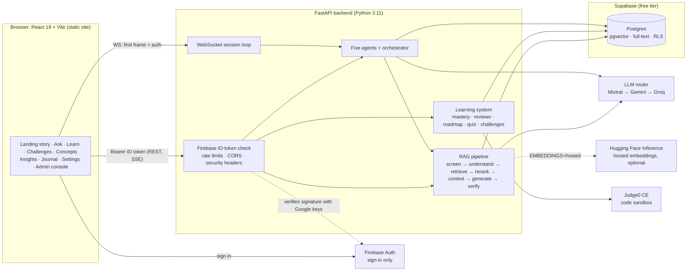
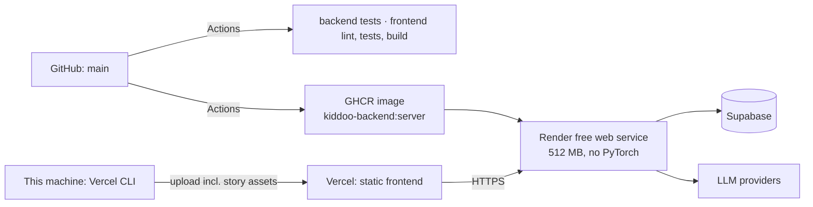

# Architecture

Kiddoo is an adaptive Data Structures and Algorithms (DSA) tutor. Its answers are **grounded, cited and verified**
against a curated knowledge base, and five cooperating agents make learner-level decisions on top of that evidence.
Every service it uses has a free tier, so the whole system runs at zero cost.

This page is the map. Each part links to the document that goes deeper:
[RAG](RAG.md) · [LEARNING](LEARNING.md) · [SECURITY](SECURITY.md) · [SETUP](SETUP.md) · [FRONTEND](FRONTEND.md) ·
[agents](agents/) · [evaluation](eval/results.md).

## System overview



## Layers and choices

| Layer | Choice | Why |
|---|---|---|
| Frontend | React 19, TypeScript, Vite 7, Tailwind 3, react-router 7, zustand, framer-motion, GSAP, three.js, Recharts, Monaco | A static bundle any free host can serve; three.js only loads inside the landing story's own chunk. |
| Sign-in | **Firebase Authentication** (email/password, Google). Sign-in only: no learner data lives in Firebase | Free, solid account handling (verification, reset, linking). |
| Token check | The backend verifies every Firebase ID token itself (RS256, Google's published keys, audience = project id, issuer, expiry) and maps the Firebase uid to a stable UUID (uuid5) | The server never trusts a `user_id` from the client; the Postgres `user_id uuid` columns stay unchanged. A legacy Supabase-JWT mode still exists for projects without `FIREBASE_PROJECT_ID`. |
| Data | **Supabase Postgres** with `pgvector` (HNSW), full-text (GIN `tsvector`) and row-level security (as a second layer, see the data model) | One free, hosted store for relational data, vectors and keyword search. |
| Embeddings | `BAAI/bge-small-en-v1.5` (384-d) running locally, or the same model through Hugging Face Inference (`EMBEDDINGS=hosted`) | Same vectors either way, so a small server without PyTorch needs no re-ingestion. |
| Reranker | `cross-encoder/ms-marco-MiniLM-L-6-v2` (local); lexical fallback on small servers | Joint query–passage scoring fixes bi-encoder near-misses. |
| Claim checker | NLI cross-encoder `nli-deberta-v3-xsmall` blended with word/embedding overlap; lexical fallback | Per-sentence faithfulness check without a second LLM call. |
| LLM | Router over **Mistral** (`ministral-14b/8b`, `open-mistral-nemo`), **Gemini** (`gemini-flash-latest`, `-lite`) and **Groq** (`llama-3.3-70b-versatile`, `llama-3.1-8b-instant`), in `LLM_PROVIDERS` order | Key rotation, model walk on 429/5xx, cool-down for a dead provider, response cache, and an extractive cited answer if every provider is down. Mistral's `pixtral-12b` reads hand-drawn diagrams only. |
| Code execution | Judge0 CE (public instance, or self-hosted with `docker-compose.judge0.yml`) | Real execution against hidden tests; time and memory are reported only if the engine returns them. |
| Offline / CI | SQLite (FTS5 BM25) store + hashing embedder + mocked LLM and HTTP | Same interfaces as production, so the whole backend suite runs with no network or model download. |

## Repository map

```
Kiddoo/
├── README.md · LICENSE · curriculum/dsa_roadmap.md          the roadmap the course notes and the city follow
├── .github/workflows/                                        ci-backend · ci-frontend · backend-image
├── .vercel/ · .vercelignore                                  frontend deploy target and upload rules
└── Production-Core/
    ├── backend/app/
    │   ├── main.py · config.py · security.py                 app wiring, settings, auth, rate limiter
    │   ├── api/v1/        rag · learning · agents · sessions · websocket · concepts · dashboard
    │   │                  code · share · auth · admin
    │   ├── rag/           chunking, ingest, stores (SQLite / Postgres), embeddings, retrieval, rerank,
    │   │                  generate, nli, guard, personalize, gaps, observability, evaluation + benchmarks
    │   ├── learning/      mastery (BKT), policy, planner, goals, diagnostic, quiz, analyst, strategy,
    │   │                  teachback, sketch, challenges, coding_profiles, journal, prefs, rhythm, study, simulate
    │   ├── agents/        knowledge · teaching · assessment · analyst · orchestrator
    │   ├── admin/         stats (aggregates only), inspect, audit
    │   ├── services/      database, rag_service, llm (agent-facing), code_execution, concept_service,
    │   │                  student_profile_service, agent_factory, activity
    │   └── tests/         411 offline tests (+5 Postgres tests that run only with TEST_DATABASE_URL)
    ├── frontend/src/
    │   ├── pages/         one file per screen
    │   ├── components/    ask · learn · concepts · dashboard · session · auth · fx · intro · landing
    │   ├── experience/    the animated landing story (see FRONTEND.md)
    │   ├── admin/         the admin console (nine pages)
    │   ├── lib/ · hooks/ · store/      API client, Firebase, theme preferences, auth store, helpers
    │   └── index.css      the shared look: skies, glass cards, light motes, themes
    ├── supabase/migrations/   0001–0010, applied in order by scripts/migrate.py
    ├── data/{knowledge,challenges,eval}/
    ├── scripts/               migrate · ingest_knowledge · smoke_test · build_challenges · verify_challenges
    ├── infrastructure/        docker-compose.yml (backend + frontend), docker-compose.judge0.yml
    └── docs/                  this documentation
```

## Single source of truth for content

`data/knowledge/*.md` (26 documents; front matter `id, title, domain, level, prerequisites, tags`) is ingested once and
feeds **both** the RAG index and the `Concept` model the agents consume (`ConceptService` derives definition,
explanations, code examples and pitfalls from the sections). The concept map's 51 edges are the real `prerequisites`,
not a hand-drawn chain. `curriculum/dsa_roadmap.md` (22 domains) drives the landing story's city.

## Request life-cycles

**Ask** (`POST /api/v1/rag/ask`, server-sent events). Stage events (`screen → understand → retrieve → rerank → context →
generate → verify`) are streamed **only when the stage actually runs**, so the progress list in the UI is a direct view
of the server trace. A weak-evidence question stops before the model is called. Details in [RAG.md](RAG.md).

**Learn** (`/api/v1/learning/*`). A check question follows an answer; `POST /learning/answer` updates Bayesian
Knowledge Tracing mastery, the spaced-review schedule, the attempt log and the teaching-style bandit. `/path`, `/plan`,
`/goal`, `/diagnostic/next`, `/insights` and `/journal` are views over that stored profile. Details in
[LEARNING.md](LEARNING.md).

**Live session** (`/api/v1/ws/session/{id}`). The first WebSocket frame is `{"type":"auth","token":…}`; only after it
verifies is the connection registered, keyed by `user_id:session_id`. The loop handles `start_session`,
`student_response`, `request_hint`, `stop_generation` and `end_session` through the orchestrator.

**Challenges and code.** `/learning/challenges/*` grades a submission against hidden tests through Judge0;
`/code/run/` powers the Playground. Hints cost a little mastery credit.

**Share.** A learner creates a named, expiring (30 days), revocable link (`/share`). `/share/view/{token}` is public,
rate limited, and built from an allow-list of fields.

**Admin** (`/api/v1/admin/*`, every route needs an admin). Overview, learners, challenges, answer quality,
system health, content gaps, engagement, a question inspector, announcements, an audit log and a few tools.
Aggregates only: groups smaller than `ADMIN_MIN_GROUP` (5 in production) are hidden.

## Agents

The five PRD agents are real modules with measurable behaviour. Thresholds and formulas are in
[LEARNING.md](LEARNING.md); per-agent pages are in [agents/](agents/).

| Agent | Where | Role |
|---|---|---|
| Knowledge Curator | `rag/`, `agents/knowledge/` | Hybrid retrieval, rerank, evidence gate, cited and verified answers |
| Adaptive Pedagogy | `learning/strategy.py`, `rag/personalize.py`, `agents/teaching/` | Teaching-style bandit; explanation level and prerequisite hints from measured mastery |
| Comprehensive Evaluator | `learning/quiz.py`, `challenges.py`, `agents/assessment/` | Grounded questions, hints, confidence, code challenges graded by real execution |
| Behavioural Analyst | `learning/analyst.py`, `agents/analyst/` | Struggle, rushing, slow, plateau, misconceptions, calibration, best time of day |
| Master Orchestrator | `learning/policy.py`, `planner.py`, `goals.py`, `diagnostic.py`, `agents/orchestrator/` | Advance / deepen / review / remediate, 60/25/15 session plan, goal feasibility, adaptive placement |

Every decision is written to `agent_events` with its reasoning and shown in *Insights*. Agents communicate through the
learner profile (JSONB) and the events table; there is no message bus, which keeps the data flow inspectable.

## Data model (`supabase/migrations`)

| Migration | Adds |
|---|---|
| `0001_init` | `documents`, `chunks` (section + passage, embedding, generated `fts`, HNSW and GIN indexes), the `match_chunks_dense` / `match_chunks_bm25` SQL functions, `profiles`, `concept_mastery`, `sessions`, `interactions`, `agent_events`, `rag_requests` |
| `0002_app_tables` | `documents.domain`, `student_profiles` (JSONB learner model), `code_submissions` |
| `0003`–`0005` | `quiz_items` with option provenance and hints |
| `0006_content_gaps` | refused questions, **no user column** |
| `0007_progress_shares` | share links, SHA-256 hashed tokens |
| `0008_firebase_auth` | drops the foreign keys to `auth.users` (Firebase uids are mapped to UUIDs instead) |
| `0009_admin_console` | `announcements`, `admin_audit` |
| `0010_account_lookup_index` | an index that the removed account lookup used; harmless, and unused now |

RLS is enabled on every table as a second layer, but **it does not isolate learners**: the API connects with the database's
owner role (which bypasses RLS), and the policies use `auth.uid()`, which never matches a Firebase user (their ids are mapped
to UUIDs by the API). Per-learner isolation is done by the API itself: every query is scoped with `where user_id = <the uid
from the verified token>`. Knowledge tables are read-only to users; `rag_requests`, `content_gaps`, `announcements` and
`admin_audit` have RLS on and no policy at all. Moving to a dedicated non-owner database role with policies keyed on a
session variable is the open hardening step.

## Frontend in one paragraph

A static single-page app. Public routes: `/` (landing), `/login`, `/register`, `/shared/:token`. Everything else sits
behind `ProtectedRoute`: `/dashboard`, `/ask`, `/learn`, `/challenges`, `/concepts`, `/visualize`, `/playground`,
`/insights`, `/journal`, `/lab`, `/settings`, `/session/:id`, `/home` and `/admin/*`. `lib/api.ts` attaches the Firebase
ID token to every request. Looks and preferences (theme, text size, floating light, reduced motion, contrast) are
stored in the browser and in the learner's settings. The landing page plays an animated story first; see
[FRONTEND.md](FRONTEND.md).

## Deployment topology



* **Backend, small host:** `backend/Dockerfile.server` (no torch, `EMBEDDINGS=hosted`, peaks near 160 MB). A larger host
  can use `backend/Dockerfile`, which bakes the three models in for full quality.
* **Frontend:** built by Vercel (`npm run build`, publish `dist/`). It is deployed with the Vercel CLI from the
  maintainer's machine, **not** by a push, because the story's placeholder asset files are kept out of git
  ([ASSET-TODO](../frontend/ASSET-TODO.md)).
* **CI:** `ci-backend` runs the pytest suite, `ci-frontend` runs lint, unit tests and the build (whose `check-dist` step
  fails if a forbidden file reaches `dist/`), `backend-image` publishes the small-server image on pushes to `main`.

## Engineering decisions worth knowing

* **Store behind an interface.** `KnowledgeStore` (SQLite) and `PostgresKnowledgeStore` expose the same methods;
  retrieval for Postgres runs inside SQL functions, so no vectors are held in app memory.
* **Hierarchical chunks.** Sections are parents, ~700-character passages are the retrieval unit; code fences are never
  split; headings are prefixed to what is embedded (contextual retrieval).
* **Honest degradation.** LLM down → extractive, cited answer. Hosted embeddings down → keyword search. Retrieval down →
  clear error. Weak evidence → "I don't have enough evidence" without calling the model.
* **No fabricated metrics.** Achievements are computed from stored progress; agent activity is read from
  `agent_events`; code-run time and memory are reported only if the engine returns them; the live session's answers, grading and
  analysis are real or say plainly that they cannot be. The dashboard's *Time invested* is an estimate from timed answers (capped at 5 minutes each) and says so.
* **Bounded growth.** `services/retention.py` prunes question logs (90 days), playground runs (180 days) and content gaps (90 days) at start-up and daily.
* **Privacy by construction.** Content gaps carry no user; admin views are aggregates with a minimum group size; share
  links expose an allow-list of fields; per-learner data is stripped before a trace reaches the admin buffer.
* **One decorative particle.** The sign-in pages, the landing hero and every app page share one `Motes` component
  (soft rising light), switchable in *Settings → Appearance → Floating light* or by *Reduce motion*.
